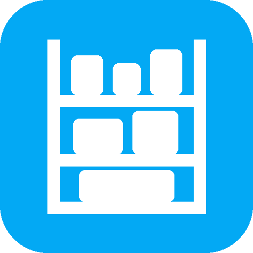
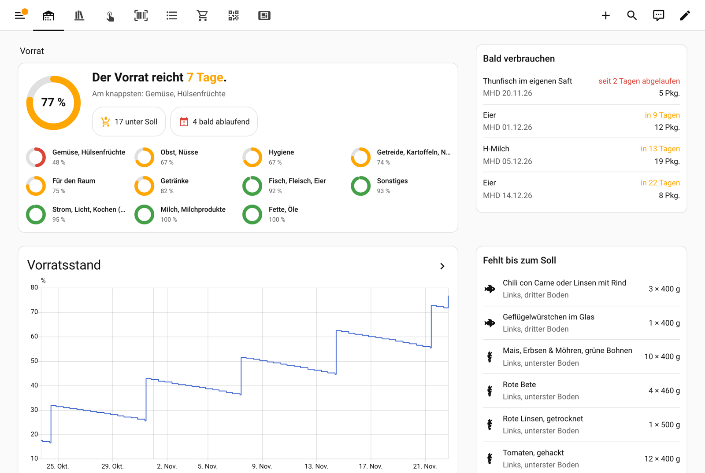
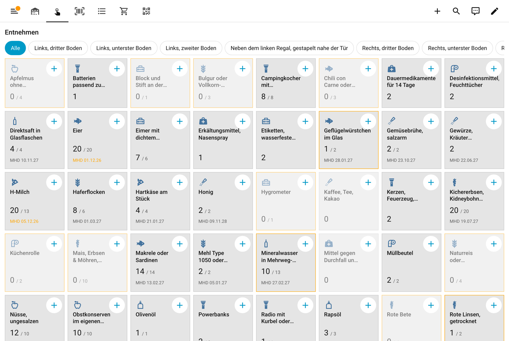
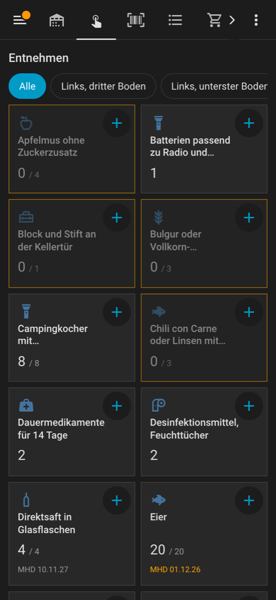
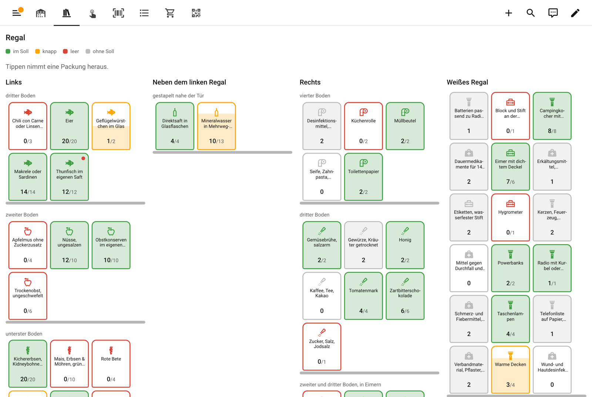
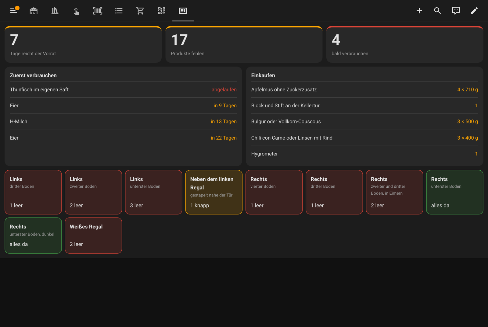

<p align="center">
  
</p>

<h1 align="center">Vorratskeller (pantry) for Home Assistant</h1>

<p align="center">
  <b>What's there, what's missing, what expires soon.</b><br>
  An inventory book for your pantry, entirely inside Home Assistant: no extra server, no cloud account.
</p>

<p align="center">
  <a href="README.md">Deutsch</a> · <b>English</b>
</p>

<p align="center">
  <a href="https://github.com/sunnyhd/ha-vorratskeller/actions/workflows/validate.yml"></a>
  
  
  <a href="LICENSE"></a>
</p>



<sub>Screenshots show the German interface; with Home Assistant set to English, everything appears in English.</sub>

## Features

- 📦 **Batches with best-before dates:** every time you store something it becomes a batch with a
  best-before date. Taking out follows FIFO: what expires first goes first.
- 🎯 **Target per product:** starts with a 14-day emergency supply following the recommendations of the
  German food and civil protection agencies (BLE, BBK), scaled to people and days. Every target can be changed.
- 👆 **Take out with one tap:** one tile per product, filterable by shelf, with “Undo”.
- 📷 **Camera scanner:** EAN barcodes on packs and QR labels on shelves. Unknown barcodes are looked up on
  Open Food Facts; only the number is sent.
- 🛒 **Shopping list:** whatever falls below target lands on a Home Assistant to-do list.
- 🔔 **Weekly report** as a push notification: what expires soon and what is missing.
- 📊 **Own dashboard** that builds itself, like the Energy dashboard.
- 🏷️ **Shelf labels** with QR codes to print.
- 🌐 **German and English:** the interface follows each user's language; product names, units and
  notifications follow the system language of Home Assistant.

<table>
  <tr>
    <td width="62%"></td>
    <td></td>
  </tr>
</table>





## Installation

1. **Add the repository**
   - Home Assistant 2026.11 and later: *Settings → Marketplace →* menu top right *→ Add from link*,
     enter `sunnyhd/ha-vorratskeller`, type *Integration*.
   - Up to 2026.10: *HACS →* menu *→ Custom repositories →*
     `https://github.com/sunnyhd/ha-vorratskeller`, category *Integration*.
2. Install **Vorratskeller** and restart Home Assistant.
3. *Settings → Devices & services → Add integration →* **Vorratskeller**.
   Take over the checklist, enter people and days.
4. **Dashboard:** *Settings → Dashboards → Add dashboard →* **Pantry (Vorratskeller)** under
   *Community dashboards*. Title and icon are prefilled, just press “Create”.
   Alternatively create an empty dashboard and enter in the raw configuration editor:

   ```yaml
   strategy:
     type: custom:vorratskeller
   ```

5. **Options** of the integration: shopping list (`todo` entity), target of the push notification
   (e.g. `notify.mobile_app_phone`), weekday and time of the report, warning period for
   “expiring soon”, Open Food Facts on or off.

Minimum version: Home Assistant 2026.10.

## Dashboard

| View | Content |
|---|---|
| Overview | ring with stock level, days of supply, fill level per group, batches expiring soon, products below target, history |
| Shelves | the shelves drawn as a rack, each product as jar, can, bottle or pack, filled by stock (green at target, orange low, red empty); a tap takes out one pack |
| Take out | one tile per product, filterable by shelf. A tap takes out one pack (with “Undo”), **+** stores one |
| Scanner | camera or manual entry: barcode (EAN) or shelf code |
| Stock | all products by group |
| Shopping | what is missing to reach the target |
| Labels | one QR code per shelf to print |
| 3D | the pantry as a 3D model with coloured products on the shelves; dimensions optional in YAML (see below) |
| Panel | for a wall tablet: big numbers, what to use first and what to buy, each shelf as a field in the colour of its scarcest product; tap opens the shelf |

The card is also available on its own: `type: custom:vorratskeller-card` with
`modus: kopf | regal | raum | panel | entnahme | scanner | fehlend | ablaufend | etiketten` (overview, shelves, 3D room, wall panel, take out, scanner, missing, expiring, labels)
and optionally `fach: <shelf id>`.

### 3D view

The **3D** view places the shelves side by side along the back wall; boards and positions come from the shelf
names (“Left, third shelf”). If you know your room's dimensions, add them to the dashboard configuration (raw
configuration editor), in metres; `x` to the right, `z` from the door into the room, `drehung: 90` for shelves
along a side wall, `boeden: 0` for stacks on the floor:

```yaml
strategy:
  type: custom:vorratskeller
  raum: { breite: 3, tiefe: 4, hoehe: 2.25 }
  regale:
    - { name: Left, x: 0.25, z: 2.55, laenge: 2.4, tiefe: 0.4, hoehe: 2.0, boeden: 5, drehung: 90 }
    - { name: Right, x: 2.75, z: 2.95, laenge: 1.6, tiefe: 0.4, hoehe: 2.0, boeden: 5, drehung: 90 }
```

Tap selects a product and shows stock, best-before date and the Take out and Store buttons. The 3D library
(three.js) ships with the integration and only loads when the view is opened.

### Labels

The **Labels** view prints one QR code per shelf on Avery Zweckform label sheets: L4776 (99.1 × 42.3 mm,
weatherproof film, 12 per sheet, recommended for cellars), 3474 (70 × 37 mm, paper, 24 per sheet) or plain paper.
Print once with outlines on plain paper, hold it against the sheet and correct any offset in mm; “Start at
position” uses partly used sheets. Choose 100 % scale and no margins in the print dialog.

## Entities

| Entity | State | Attributes |
|---|---|---|
| `sensor.vorratskeller_<product>` | stock in packs | target, shortfall, next best-before date, days to it, batches, shelf, barcodes |
| `sensor.vorratskeller_fehlende_produkte` | number of products below target | list with shortfalls |
| `sensor.vorratskeller_bald_ablaufend` | batches within the warning period (including expired) | batches with days left |
| `sensor.vorratskeller_reichweite` | days the supply lasts (scarcest group) | days per group, bottleneck (`engpass`) |
| `sensor.vorratskeller_vorratsstand` | share of the target in % | |

## Services

| Service | Purpose |
|---|---|
| `vorratskeller.einlagern` | store: product (ID, entity or barcode), quantity, best-before date |
| `vorratskeller.entnehmen` | take out by FIFO; if stock is insufficient, nothing changes |
| `vorratskeller.inventur` | set the counted stock |
| `vorratskeller.barcode_zuordnen` | assign a barcode to a product |
| `vorratskeller.barcode_suchen` | product for a barcode, otherwise a suggestion from Open Food Facts |
| `vorratskeller.produkt_anlegen` / `produkt_aendern` / `produkt_loeschen` | create / change / delete products |
| `vorratskeller.einkaufsliste_abgleichen` | put missing products on the shopping list |
| `vorratskeller.bericht_senden` | send the weekly report now |

Service and field descriptions are translated in the Home Assistant UI.

### Example: warning when supplies run low

```yaml
automation:
  - alias: Pantry lasts less than a week
    triggers:
      - trigger: numeric_state
        entity_id: sensor.vorratskeller_reichweite
        below: 7
    actions:
      - action: notify.mobile_app_phone
        data:
          title: Pantry
          message: >-
            Supplies last {{ states('sensor.vorratskeller_reichweite') }} more days,
            scarcest is {{ state_attr('sensor.vorratskeller_reichweite', 'engpass') }}.
```

## Privacy

- Everything stays in Home Assistant. No account, no server of its own, no telemetry.
- The only outbound request goes to Open Food Facts, and only for an unknown barcode:
  the barcode number, without cookies and without any identifier of your home. Can be switched off.
- Barcode detection in the browser loads nothing from the internet; the integration ships all libraries.

## Data

The inventory book is stored in `.storage/vorratskeller` and is part of every Home Assistant backup.
Removing the integration keeps it; setting it up again loads it.

## Licence

MIT, see [`LICENSE`](LICENSE). Bundled libraries: MIT (barcode-detector, zxing-wasm, qrcode-generator, three.js)
and Apache 2.0 (zxing-cpp).
