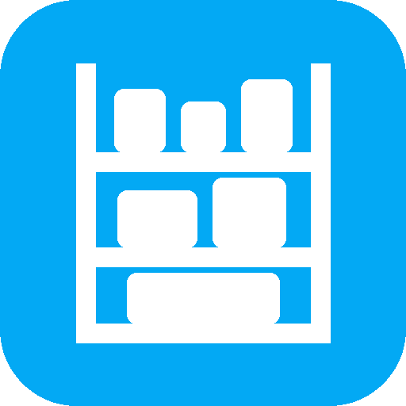
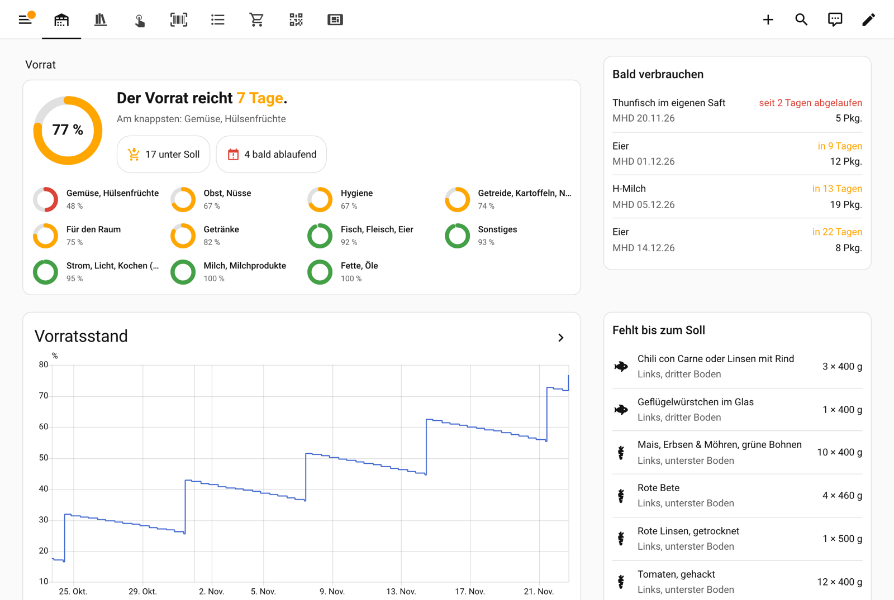
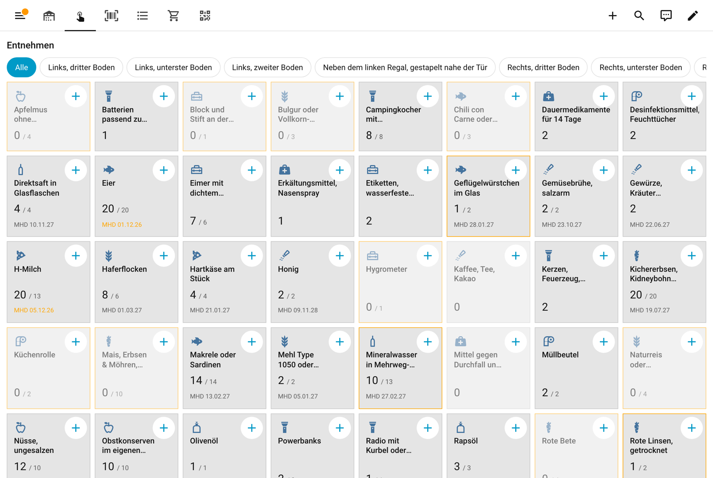
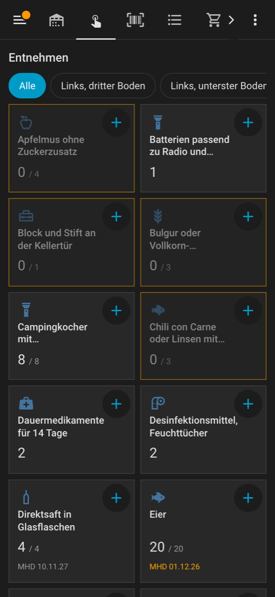
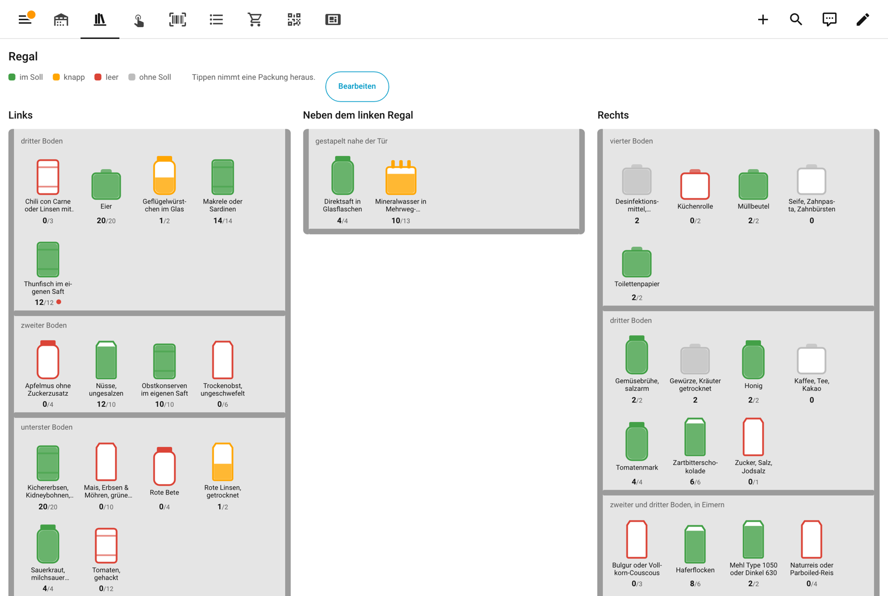
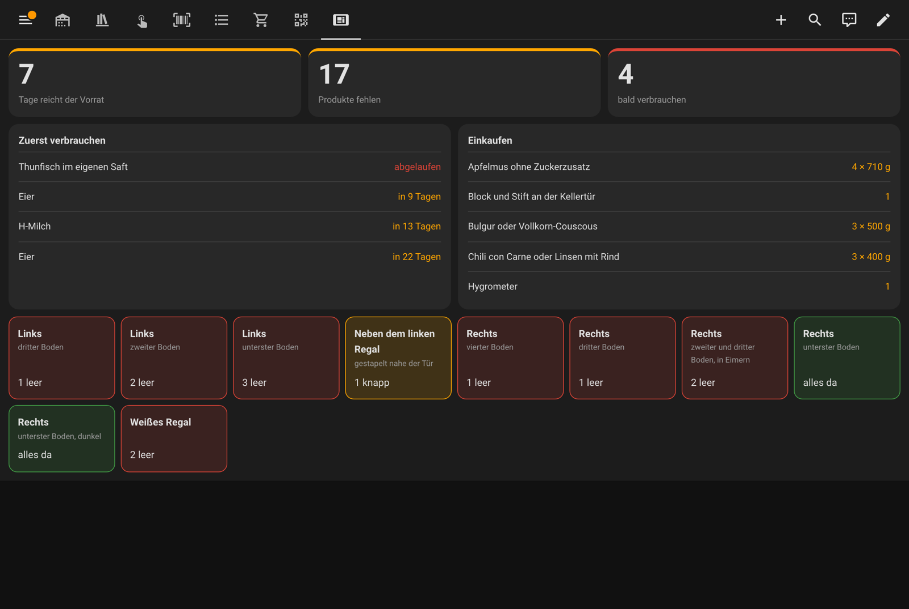
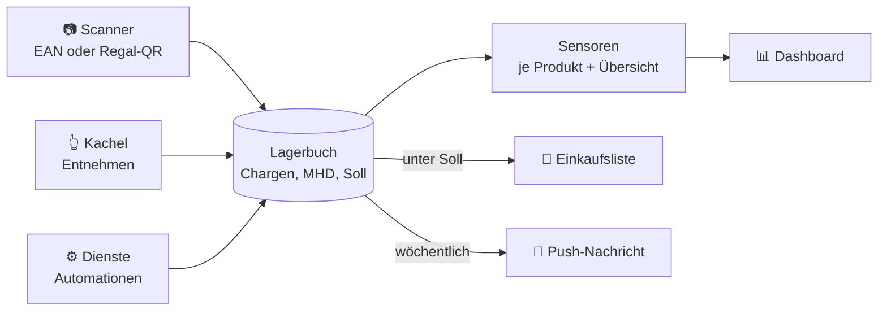
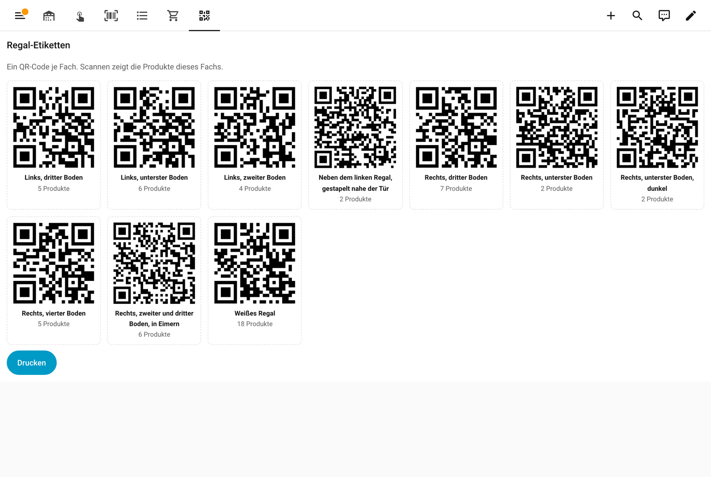

<p align="center">
  
</p>

<h1 align="center">Vorratskeller für Home Assistant</h1>

<p align="center">
  <b>Was ist da, was fehlt, was läuft bald ab.</b><br>
  Lagerbuch für den Vorratskeller, ganz in Home Assistant: ohne Zusatzserver, ohne Cloud-Konto.
</p>

<p align="center">
  <b>Deutsch</b> · <a href="README.en.md">English</a>
</p>

<p align="center">
  <a href="https://github.com/sunnyhd/ha-vorratskeller/actions/workflows/validate.yml"></a>
  
  
  <a href="LICENSE"></a>
</p>



## Was es kann

- 📦 **Lagerbuch mit Chargen:** Jede Einlagerung ist eine Charge mit Mindesthaltbarkeitsdatum (MHD).
  Entnommen wird nach FIFO: was zuerst abläuft, geht zuerst raus.
- 🎯 **Soll je Produkt:** Startet mit einem 14-Tage-Notvorrat nach den Empfehlungen von BLE und BBK,
  umgerechnet auf Personen und Tage. Jedes Soll lässt sich ändern.
- 👆 **Entnehmen mit einem Tipp:** eine Kachel je Produkt, nach Regalfach filterbar, mit „Rückgängig“.
- 📷 **Kamera-Scanner:** EAN-Barcodes auf der Packung und QR-Etiketten am Regal. Unbekannte Barcodes
  schlägt Open Food Facts vor; dorthin geht nur die Nummer.
- 🛒 **Einkaufsliste:** Was unter Soll fällt, landet automatisch auf einer To-do-Liste von Home Assistant.
- 🔔 **Wochenbericht** als Push-Nachricht: was bald abläuft und was fehlt.
- 📊 **Eigenes Dashboard**, das sich selbst aufbaut, wie das Energie-Dashboard.
- 🏷️ **Regal-Etiketten** mit QR-Code zum Ausdrucken.
- 🌐 **Deutsch und Englisch:** Die Oberfläche folgt der Sprache des Benutzers; Produktnamen, Einheiten
  und Nachrichten folgen der Systemsprache von Home Assistant.

<table>
  <tr>
    <td width="62%"></td>
    <td></td>
  </tr>
  <tr>
    <td align="center"><sub>Entnehmen: Bestand / Soll, nächstes MHD, <b>+</b> lagert ein</sub></td>
    <td align="center"><sub>Auf dem Handy, dunkles Design</sub></td>
  </tr>
</table>





## So greift es ineinander



## Installation

1. **Repository hinzufügen**
   - Ab Home Assistant 2026.11: *Einstellungen → Marketplace →* Menü oben rechts *→ Add from link*,
     `sunnyhd/ha-vorratskeller` eintragen, Typ *Integration*.
   - Bis 2026.10: *HACS →* Menü *→ Benutzerdefinierte Repositories →*
     `https://github.com/sunnyhd/ha-vorratskeller`, Kategorie *Integration*.
2. **Vorratskeller** installieren und Home Assistant neu starten.
3. *Einstellungen → Geräte & Dienste → Integration hinzufügen →* **Vorratskeller**.
   Checkliste übernehmen, Personen und Tage angeben.
4. **Dashboard:** *Einstellungen → Dashboards → Dashboard hinzufügen →* **Vorratskeller**
   (unter den Community-Dashboards). Titel und Symbol sind vorbelegt, nur noch „Erstellen“. Alternativ ein leeres Dashboard anlegen und im
   Raw-Konfigurationseditor eintragen:

   ```yaml
   strategy:
     type: custom:vorratskeller
   ```

5. **Optionen** der Integration: Einkaufsliste (`todo`-Entität), Ziel der Push-Nachricht
   (z. B. `notify.mobile_app_handy`), Wochentag und Uhrzeit des Berichts, Vorlauf für
   „läuft bald ab“, Open Food Facts an oder aus.

Mindestversion: Home Assistant 2026.10.

## Dashboard

Die Strategie baut das ganze Dashboard aus den Entitäten, ähnlich wie das Energie-Dashboard:

| Ansicht | Inhalt |
|---|---|
| Übersicht | Ring mit Vorratsstand, Reichweite in Tagen, Füllstand je Gruppe, bald ablaufende Chargen, Produkte unter Soll, Verlauf |
| Regal | die Fächer als Regal gezeichnet, jedes Produkt als Glas, Dose, Flasche oder Packung, gefüllt nach Bestand (grün im Soll, orange knapp, rot leer); Tippen nimmt eine Packung heraus |
| Entnehmen | eine Kachel je Produkt, nach Fach filterbar. Tippen nimmt eine Packung heraus (mit „Rückgängig“), **+** lagert eine ein |
| Scanner | Kamera oder Eingabe von Hand: Barcode (EAN) oder Regal-Code |
| Bestand | alle Produkte nach Gruppen |
| Einkauf | was bis zum Soll fehlt |
| Etiketten | ein QR-Code je Fach zum Ausdrucken |
| Panel | für das Tablet an der Kellertür: große Zahlen, was zuerst verbraucht und was eingekauft werden muss, jedes Fach als Feld in der Farbe seines knappsten Produkts; antippen zeigt das Fach |

Die Karte gibt es auch einzeln: `type: custom:vorratskeller-card` mit
`modus: kopf | regal | panel | entnahme | scanner | fehlend | ablaufend | etiketten` und optional `fach: <kennung>`.

### Scanner

- Barcode bekannt: Menge und MHD eingeben, einlagern oder entnehmen.
- Barcode unbekannt: einem vorhandenen Produkt zuordnen oder neues Produkt anlegen.
  Den Namensvorschlag holt die Integration bei Open Food Facts; dorthin geht **nur die
  Barcode-Nummer**, ohne Kennung des Hauses. In den Optionen abschaltbar.
- Regal-Code (`VK:F:<fach>`): zeigt die Produkte dieses Fachs als Entnahme-Kacheln.
- Die Kamera braucht eine verschlüsselte Verbindung (https) oder `localhost`.
  Ohne Kamera geht die Eingabe von Hand.
- Erkennung: `BarcodeDetector` des Browsers, sonst zxing-wasm. Die WebAssembly-Datei liefert
  die Integration selbst aus; es wird nichts von einem CDN geladen.



### Produkte und Fächer bearbeiten

Im Reiter **Regal** schaltet „Bearbeiten“ in den Bearbeiten-Modus: Ein Tipp auf ein Produkt öffnet Name, Fach,
Soll, Packung und Form im Regal (z. B. Flasche). Der Stift neben einem Regal oder Boden benennt es um; das Regal ist
der Teil des Fachnamens vor dem Komma, der Boden der Teil danach. Weil der QR-Code am Fachnamen hängt, danach die
Etiketten der umbenannten Fächer neu drucken. In Automationen: `vorratskeller.fach_umbenennen` mit `alt` und `neu`.

- **Neues Produkt ohne Barcode** (Eier, Obst, Selbstgemachtes): im Bearbeiten-Modus „+ Produkt“.
- **Löschen:** im Bearbeiten-Dialog, nur für Administratoren, mit Rückfrage.
- **Lagerort:** Produkte können an einem zweiten Ort liegen, z. B. „Küche“ (leer = Keller). Gibt es mehr als
  einen Ort, filtern Chips in Regal und Entnehmen nach Ort; Etiketten zeigen den Ort mit an.
- **Einlagern mit MHD:** „+“ beim Entnehmen fragt Menge und MHD ab, vorbelegt mit der üblichen Haltbarkeit.
  Produkte ohne MHD (Haltbarkeit 0) lagern weiter mit einem Tipp ein.

### Etiketten

Die Ansicht **Etiketten** druckt einen QR-Code je Fach auf Etikettenbögen von Avery Zweckform:

| Bogen | Format | Je Blatt | Wofür |
|---|---|---|---|
| L4776 | 99,1 × 42,3 mm, wetterfeste Folie | 12 | Keller und feuchte Räume (empfohlen) |
| 3474 | 70 × 37 mm, Papier | 24 | trockene Räume |
| Normalpapier | 60 × 60 mm | 12 | zum Ausschneiden |

Gebraucht wird ein Etikett je Fach; die Ansicht zeigt Anzahl, Bögen und freie Felder. Beispiel: 10 Fächer
passen auf einen Bogen L4776, 2 Felder bleiben für spätere Fächer. Hat ein Fach sehr viele Produkte (etwa ein
ganzes Regal unter einem Namen), zeigt ein Scan eine lange Liste; nach Böden aufgeteilte Fächer ergeben kürzere
Listen, brauchen aber mehr Etiketten. L4776 gibt es meist nur zu 20 Bögen (240 Etiketten), das reicht für Jahre;
für den Probedruck genügt Normalpapier.

Die Ränder sind mittig auf A4 gerechnet. Zum Ausrichten zuerst mit „Rahmen mitdrucken“ auf Normalpapier drucken,
gegen den Bogen ins Licht halten und Abweichungen mit dem Versatz in mm ausgleichen. „Beginnen bei Feld“
nutzt angebrochene Bögen. Im Druckdialog Skalierung 100 % und keine Ränder wählen.

## Entitäten

| Entität | Zustand | Attribute |
|---|---|---|
| `sensor.vorratskeller_<produkt>` | Bestand in Packungen | Soll, Fehlmenge, nächstes MHD, Tage bis MHD, Chargen, Fach, Barcodes |
| `sensor.vorratskeller_fehlende_produkte` | Anzahl unter Soll | Liste mit Fehlmengen |
| `sensor.vorratskeller_bald_ablaufend` | Anzahl Chargen bis zum Vorlauf (auch abgelaufene) | Chargen mit Tagen bis MHD |
| `sensor.vorratskeller_reichweite` | Tage, die der Vorrat reicht (knappste Gruppe) | Tage je Gruppe, Engpass |
| `sensor.vorratskeller_vorratsstand` | Anteil des Solls in % | |

Reichweite je Gruppe = vorhandene Menge (Packungen × Packungsmenge in kg oder l) ÷
(Ziel der Gruppe ÷ 14 Tage). Gezählt werden nur Gruppen mit Ziel (Lebensmittel und Getränke).

## Dienste

| Dienst | Zweck |
|---|---|
| `vorratskeller.einlagern` | Produkt (Kennung, Entität oder Barcode), Menge, MHD. Ohne MHD: heute + übliche Haltbarkeit |
| `vorratskeller.entnehmen` | nach FIFO: früheste MHD zuerst, Chargen ohne MHD zuletzt. Reicht der Bestand nicht, ändert sich nichts |
| `vorratskeller.inventur` | gezählten Bestand setzen |
| `vorratskeller.barcode_zuordnen` | Barcode einem Produkt zuordnen (wird bei einem anderen Produkt entfernt) |
| `vorratskeller.barcode_suchen` | Produkt zum Barcode, sonst Vorschlag von Open Food Facts (Antwort) |
| `vorratskeller.produkt_anlegen` / `produkt_aendern` / `produkt_loeschen` | Stammdaten, mit `form` und `ort` |
| `vorratskeller.fach_umbenennen` | Fach in allen Produkten umbenennen (`alt`, `neu`, optional `ort`) |
| `vorratskeller.einkaufsliste_abgleichen` | fehlende Produkte auf die Einkaufsliste |
| `vorratskeller.bericht_senden` | Wochenbericht sofort senden |

Alle Änderungen landen mit Zeit und Benutzer im Journal.

## Automatik

- **Einkaufsliste:** Fällt ein Produkt unter Soll, kommt es als „Name (Vorrat)“ auf die
  gewählte Liste. Ein offener Eintrag mit gleichem Text verhindert Dubletten; ist er
  abgehakt und das Produkt fehlt erneut, kommt es wieder auf die Liste.
- **Wochenbericht:** am gewählten Tag zur gewählten Uhrzeit, was bald abläuft, was über Soll liegt und bald
  aufgebraucht werden sollte, und welche Produkte unter Soll sind.

### Blueprint für Push-Nachrichten

[](https://my.home-assistant.io/redirect/blueprint_import/?blueprint_url=https%3A%2F%2Fgithub.com%2Fsunnyhd%2Fha-vorratskeller%2Fblob%2Fmain%2Fblueprints%2Fautomation%2Fvorratskeller%2Fpush_vorrat.yaml)

Für eigene Tage und Uhrzeiten, mehrere Empfänger und Nachrichten nur dann, wenn es etwas zu melden gibt:
Blueprint importieren, dann unter Einstellungen → Automationen → Blueprints eine Automation daraus anlegen.
Einstellbar: Empfänger (`notify`-Entitäten), Uhrzeit, Wochentage, ab wie vielen Tagen vor dem MHD gemeldet wird,
fehlende Produkte mitschicken. Die Texte des Blueprints sind deutsch.

### Beispiel: Warnung, wenn der Vorrat knapp wird

```yaml
automation:
  - alias: Vorrat reicht keine Woche mehr
    triggers:
      - trigger: numeric_state
        entity_id: sensor.vorratskeller_reichweite
        below: 7
    actions:
      - action: notify.mobile_app_handy
        data:
          title: Vorratskeller
          message: >-
            Der Vorrat reicht noch {{ states('sensor.vorratskeller_reichweite') }} Tage,
            knapp ist {{ state_attr('sensor.vorratskeller_reichweite', 'engpass') }}.
```

## Datenschutz

- Alles bleibt in Home Assistant. Kein Konto, kein eigener Server, keine Telemetrie.
- Nach außen geht nur eine Anfrage an Open Food Facts, und nur wenn ein Barcode unbekannt ist:
  die Barcode-Nummer, ohne Cookies und ohne Kennung des Hauses. In den Optionen abschaltbar.
- Die Barcode-Erkennung im Browser lädt nichts aus dem Netz; alle Bibliotheken liefert die
  Integration selbst aus.

## Daten

Das Lagerbuch liegt in `.storage/vorratskeller` und ist damit in jedem Backup von Home
Assistant enthalten. Beim Entfernen der Integration bleibt es erhalten; beim erneuten
Einrichten wird es wieder geladen.

## Entwicklung

```bash
uv venv --python 3.14 .venv
uv pip install --python .venv/bin/python \
  pytest-homeassistant-custom-component==0.13.375 home-assistant-frontend==20260930.5 ruff
.venv/bin/python -m pytest tests -q
node --test tests/frontend/*.test.mjs
```

Home Assistant lokal: `config/configuration.yaml` anlegen (gitignored), `custom_components`
dorthin verlinken, `.venv/bin/hass -c config`. Fremdbibliotheken unter
`custom_components/vorratskeller/frontend/vendor` baut `scripts/vendor.sh`;
Lizenzen in `frontend/vendor/LICENSES.md`.

## Quellen

- BLE: [Vorratskalkulator](https://www.ernaehrungsvorsorge.de/private-vorsorge/notvorrat/vorratskalkulator/)
  und [Lagerung von Lebensmitteln](https://www.ernaehrungsvorsorge.de/private-vorsorge/empfehlungen-tipps/so-koennen-lebensmittel-gelagert-werden)
- BBK: [Ratgeber und Checkliste](https://www.bbk.bund.de/DE/Warnung-Vorsorge/Vorsorge/Ratgeber-Checkliste/ratgeber-checkliste_node.html)
- Produktdaten: [Open Food Facts](https://world.openfoodfacts.org/) (ODbL)

## Lizenz

MIT, siehe [`LICENSE`](LICENSE). Mitgelieferte Bibliotheken: MIT (barcode-detector, zxing-wasm,
qrcode-generator) und Apache 2.0 (zxing-cpp).
